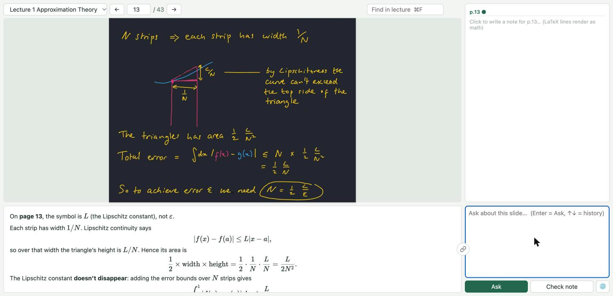
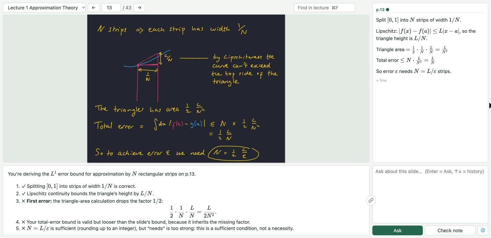
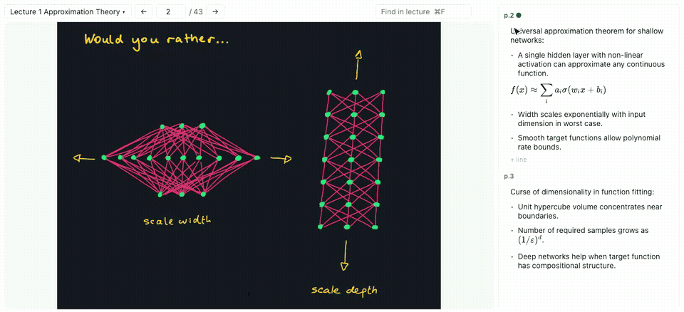
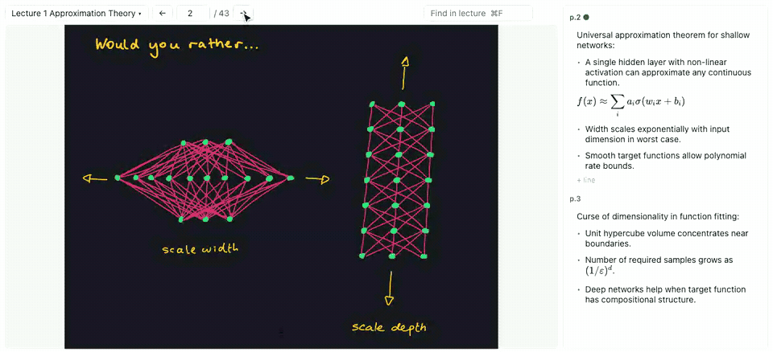
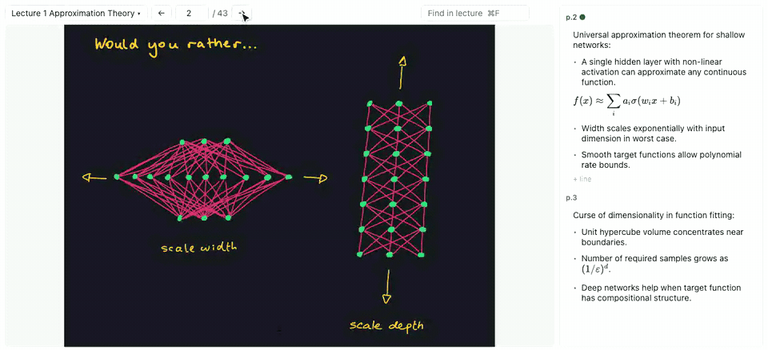
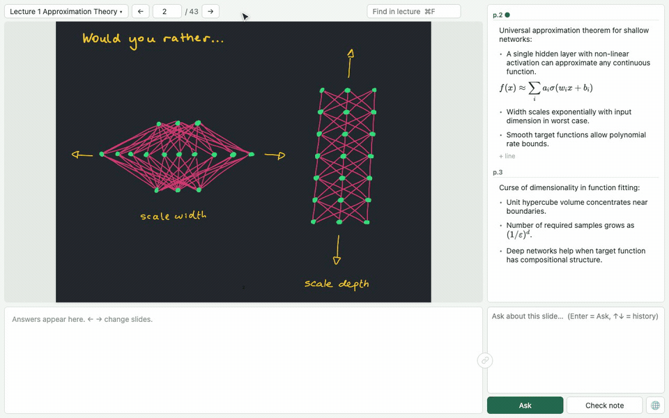

# slide-tutor

A local course slide reader with per-page notes and an AI tutor that sees the slide you're on. Runs from the macOS menu bar or the Windows tray.



*Check note reviews the current page's note step by step:*



## Setup
macOS (for Windows, see [Windows](#windows)); requires Python 3.10+.

```sh
git clone https://github.com/dandruff2022/slide-tutor.git
cd slide-tutor
./run.sh
```

`run.sh` creates `.venv`, installs the requirements and starts the menu bar app (a small book icon).
Then, from the icon: **Set API Key…** (an [Anthropic API key](https://console.anthropic.com/)) and **Add Slides Folder…**.

## Windows
Requires Python 3.10+. Double-click `run.cmd`: it creates `.venv`, installs the requirements and starts `tray_win.py`
(a blue book icon in the notification area; Windows may hide it under the **^** arrow).

The tray works like the macOS menu bar (left or right click opens the menu), with two differences: **Edit Settings…** opens the `env` file in Notepad (it
replaces **Set API Key…**; add `SLIDE_TUTOR_API_KEY=...` there), and **Restart Courses** applies your edits.
Courses and settings live in `%APPDATA%\slide-tutor\` (`courses.json`, `env`). **Launch at Login** adds a per-user
`Run` registry value. Lectures and notes behave the same; use Ctrl where this manual says ⌘.

`SLIDE_TUTOR_START_CMD` runs once when the tray starts, if `SLIDE_TUTOR_ROUTER`'s local port is closed. Its output goes
to `%APPDATA%\slide-tutor\proxy.log`, and the process keeps running after **Quit**. Example for
[antigravity-claude-proxy](https://github.com/badri-s2001/antigravity-claude-proxy):

```sh
npm install -g antigravity-claude-proxy
antigravity-claude-proxy accounts add
```

```sh
SLIDE_TUTOR_ROUTER=http://127.0.0.1:8080
SLIDE_TUTOR_MODELS=gemini-3.8-flash-tiered=Gemini 3.8 Flash
SLIDE_TUTOR_MODEL=gemini-3.8-flash-tiered
SLIDE_TUTOR_START_CMD=antigravity-claude-proxy start --log
```

## Menu bar
- **Add Slides Folder…**: pick a folder of lecture PDFs. Each course gets its own local server (ports from 8765 up);
  its lectures are the folder's PDFs (names without spaces, e.g. `Lecture3.pdf` or `Lecture3_Transformers.pdf`),
  ordered by the first number in the name. Notes, cache and logs go in `slide-tutor/data/` next to the slides folder.
- **<course> → Open** opens it in the browser; **Remove** forgets the course (its notes stay on disk).
- **Set API Key…** saves the key and restarts the courses.
- **Launch at Login** starts the menu bar app (and all courses) when you log in.

Courses are remembered in `~/Library/Application Support/slide-tutor/courses.json`; the course name (used in the
tutor's prompt) defaults to the slides folder's parent folder name and can be edited there.

## Model endpoint
By default the tutor calls the Anthropic API with your key, choosing between Claude Sonnet 5.5 and Claude Haiku 4.5
in the **🌐** menu (remembered per browser). To use another Anthropic-compatible endpoint (e.g. a LiteLLM proxy) or
other models, add `KEY=VALUE` lines to `~/Library/Application Support/slide-tutor/env` and restart the menu bar app:

```sh
SLIDE_TUTOR_ROUTER=http://127.0.0.1:4000          # endpoint base URL (POST /v1/messages, streamed)
SLIDE_TUTOR_MODELS=model-a=Model A,model-b=Model B  # choices in the 🌐 menu (id=Label,...)
SLIDE_TUTOR_MODEL=model-a                         # default choice
SLIDE_TUTOR_START_CMD=~/bin/start-my-proxy        # optional: run when the endpoint is down
```

## Layout
- **Slide** (left): lecture picker, ← → buttons, arrow keys (←↑ previous, →↓ next) or a two-finger scroll / mouse wheel over the slide (one page per gesture). The lecture menu has a bounded, scrollable list: arrows and Home/End select an item, Enter commits, Escape cancels, and Tab moves on. Choosing a lecture returns focus to the reader; clicking the slide (including selectable text) also restores page-arrow navigation. Arrows inside notes, search, the prompt, or other inputs keep their editing behavior; Escape from the prompt or page-number input returns to the reader. **⌘F** searches every page of the lecture: typing jumps to the first matching page, Enter / Shift+Enter = next / previous match, Esc clears; matches are highlighted on the slide.
- **Notes** (right): one note per lecture, grouped by page. Click a `p.N` heading to jump there. On the current page, click a line to edit just that line (others stay rendered); in a table, click a row to edit that source row, then ↑/↓ moves between rows. Dragging across text, double-clicking a word, or clicking to clear a selection selects instead of editing; with lines selected, Enter edits the first one. Enter = new line, Backspace at line start = join, ↑/↓ = move between lines, Esc or click away = done. Drag across lines to select them (touched lines are tinted red): Backspace/Delete removes them, ⌘C / Ctrl+C copies them as source; ⌘X / Ctrl+X marks them gray for a deferred move (they are removed only when pasted into notes). ⌘V / Ctrl+V pastes into notes. Drag the **⠿ handle** beside a tinted line to move all selected lines (a green line marks where they land); dragging text does not reorder notes. Hold the handle near the notes panel's top or bottom edge to scroll continuously, even without moving the pointer. Leaving the panel or ending/cancelling the drag stops scrolling; dropping outside the current note does nothing. ⌘Z / Ctrl+Z restores the last delete, move, or rendered-line paste. A line with LaTeX (`\`, `^`, `_`) and no `$` renders as display math. Saved to `slide-tutor/data/notes/LectureN.md` next to the slides folder under `## p.N` headings.

  

- **Add to note**: select text in the response → button at the response panel's top-right appends it to the current page's note (math kept as LaTeX, one equation per line).
- **Prompt** (bottom right): Enter = **Ask**, Shift+Enter = newline, ↑/↓ = previous prompts. **Check note** reviews the current page's note step by step (anything typed in the prompt is sent along, e.g. "is step 3 right?") and offers **Apply to note p.N** (cleaned LaTeX) with **Undo**. **🌐** sets the response language and the note language separately (English / Simplified Chinese). For questions worth keeping, the tutor may end with a **Suggested note**. **Add to current page (p.N)** appends it to whichever lecture/page is open when clicked, preserving that page's existing text—even if the answer was generated for another page. The label updates as you navigate. **Undo** names the actual destination and is available there; it refuses to overwrite subsequent edits. **Check note → Apply to note** remains tied to the original lecture/page and refuses replacement if the note changed since the request.
- **Response** (bottom left): latest answer only. Each request is standalone (no server-side conversation memory); questions, notes, answers, and usage events are logged locally in `slide-tutor/data/logs/events.jsonl`. It includes the current slide as a ~1000px image, the extracted text of it and its neighbors, and the current page's note. The page part (text + image) comes before the question and every request carries the same per-course session id, so repeat questions on a page reuse the provider's prompt cache (`cache_read_input_tokens` in the log). Before answering, the model may request additional context in up to two hidden lookup rounds: `[[HIRES]]` = the slide at 1600px, `[[PAGES 3-9]]` / `[[PAGES all]]` = extracted slide text, and `[[NOTES 3-9]]` / `[[NOTES all]]` = complete notes from this lecture (including empty pages). A small note index helps it choose pages without loading every note. The status line shows what it's reading; if the context limit is exceeded, ask for fewer pages.
- **🔗** (between response and prompt): grey until there's an answer. Click to link: both panels get a green border, and the next question follows up on the answers shown (they stay on screen; the last 4 Q&A are sent as text, kept only in the page). Click again, flip the page, or switch lecture to go back to standalone. A Check note answer can be followed up too: link and ask for a small change ("only rename x to y"), and the reply ends with the whole edited note plus **Apply to note p.N**. Check note while linked re-checks within the thread.

Tutor behavior: `prompts/system.md`. Tests: `.venv/bin/python -m unittest discover -s tests` and `node --test tests/*.cjs`.

Optional native Chrome gesture regression: `node tests/browser_gestures.js` (requires Playwright and Chrome). Use a fresh disposable **Review sandbox** course with the fixture described in the script; set `SLIDE_TUTOR_TEST_URL` to its separate server URL and launch that server with matching `PORT`, temporary `SLIDE_TUTOR_SLIDES` and `SLIDE_TUTOR_DATA`. The script writes only sandbox notes and makes no tutor/model calls. Never run it against real course notes.
`tests/browser_clipboard.js` and `tests/browser_navigation.js` are optional DevTools expressions, not Node scripts; paste them only into a disposable **Review sandbox** course as their headers describe. They write sandbox notes and use no real model calls.

Notes support `###` subheadings, literal numbered steps, and `-` bullets. Indent child items by two spaces; align continuation text and raw-LaTeX formulas with the text after their parent's marker (two spaces after a bullet, three after `1.`). Blank lines separate groups. These structures stay editable line by line; indentation is explicit rather than inferred from the content. Leading signs on raw formulas (for example, `- \frac{x_1}{2}`) are preserved as math, not converted to bullets. To put a raw formula in a bullet item, use an explicit `- \quad` marker or wrap the formula in math delimiters.

Autosaves compare against the last saved note, so a stale tab cannot silently overwrite another tab's changes or a reviewed batch. On a conflict, your local edits remain in the page and the status explains the failure: copy them before reloading and reconcile with the saved note. After updating the app, reload all open tutor tabs to enable these checks.

## Copying and moving note lines


Select rendered lines in the current note. **Copy** preserves their Markdown, LaTeX, and indentation. **Cut** leaves the source intact and grays it out; navigate to another page in the same lecture, select destination lines to replace or click a line to place the caret, then **Paste**. With the notes panel focused and no selection, Paste appends. A deferred move saves source and destination together; failed saves or conflicts do not remove the source. **Undo** restores both pages together and refuses to overwrite later changes.

**Escape**, another Copy/Cut, editing the source, or switching lectures cancels the pending move without deleting anything. Pasting into the prompt or another app behaves as a copy and cannot commit the move; the tutor cannot observe an external application's Paste. After a successful move, pasting again copies the text rather than deleting twice. Copy/cut and ordinary paste inside a line editor retain native text-editing behavior; only a matching deferred rendered-line Cut uses the atomic move behavior there. Browser support for custom clipboard types is required for deferred Cut; unsupported browsers safely copy instead.

## Quick note formatting


Select text in the **current page's note**, either directly in the rendered text or inside a line editor. Then type a delimiter or use the floating toolbar:

| Type after selecting | Result | Saved source |
| --- | --- | --- |
| `*` | Italic | `*text*` |
| `**` | Bold | `**text**` |
| `***` | Bold italic | `***text***` |
| `==` | Yellow highlight | `==text==` |

Consecutive stars upgrade the same selection; they do not replace its text. The toolbar also offers **yellow, green, blue, pink, and purple** marker swatches (hover for color names), shows the current marker color, and has **Clear highlight**. A new color replaces an existing highlight. Colored source uses `=={blue}text==` (substitute `green`, `pink`, or `purple`); yellow needs no color prefix. Use **Alt/Option+F10** to focus the toolbar, then Tab or ←/→ to move between controls.

Formatting saves automatically; **⌘Z** immediately after formatting restores the previous note. Multi-line selections keep list markers and indentation. Formula/code source and table syntax are left unchanged; select the surrounding prose to format it. Normal typing without a selection and the existing line copy/cut, delete, and drag actions still work. Check note preserves existing emphasis and marker colors.

## Reading and reorganizing notes across pages


Use **Ask** or **Check note** normally; there is no multi-page mode switch.

- **“Explain this using my p.5 note.”** The tutor can read that note for context. Reading does not authorize changes.
- **“Clean this up” / “Shorten my note.”** Vague instructions default to the **current page only**.
- **“Move the last paragraph from p.2 to p.5.”** Explicit cross-page intent permits a reviewed move.
- **“Split this long note across the appropriate slide pages, preserving their existing notes.”** The tutor inspects candidate slides and complete target notes, then proposes placements. If placement is unclear, it should ask rather than guess.

A cross-page proposal shows the interpreted intent, affected pages, and expandable **Before / After** Markdown source. **View slide p.N** opens the relevant slide; previewing, navigating, and cancelling do not save the proposal. An emptied source page is labeled explicitly. Existing target content should be merged, not discarded: review the complete replacements before applying.

**Apply changes to p.2, p.5** saves the whole move/split together; **Undo all changes** restores the whole group. Applied proposals keep their Undo controls when you ask a new question; **Dismiss Undo** explicitly removes that recovery control. Pending autosaves finish first, and note editing is briefly locked during the transaction. If any affected note has changed locally or on disk since the proposal, the entire operation is refused; keep your edits and ask for a fresh proposal. Undo also refuses to overwrite subsequent edits. Atomic writes preserve unrelated pages, with an exact original-file backup under `data/notes/backups/` before each batch apply/undo. Nothing is written directly by the model. This feature operates within the current lecture only; large requests may need to be narrowed.

## Platform support
slide-tutor supports both macOS and Windows. Every new feature should work on both:

- Keep behavior the same on both platforms unless a platform convention requires otherwise. Handle `metaKey` and `ctrlKey` together for shortcuts, and document real differences in this manual.
- Tray or menu changes go in both `tray.py` and `tray_win.py`; setup changes go in both `run.sh` and `run.cmd`.
- Use `pathlib` paths, and pass `encoding='utf-8'` when reading or writing text. Windows does not default to UTF-8.
- Mark platform-only dependencies in `requirements.txt` with `sys_platform`.
- Test on both platforms where possible, and say so when a feature has only been tested on one.

## Credits
Demo slides in the screenshots and GIFs: MIT 6.7960 Deep Learning, Fall 2024, Lecture 3 "Approximation Theory" by Jeremy
Bernstein, Phillip Isola and Sara Beery, [MIT OpenCourseWare](https://ocw.mit.edu/courses/6-7960-deep-learning-fall-2024/),
licensed [CC BY-NC-SA 4.0](https://creativecommons.org/licenses/by-nc-sa/4.0/). Code: MIT License.
